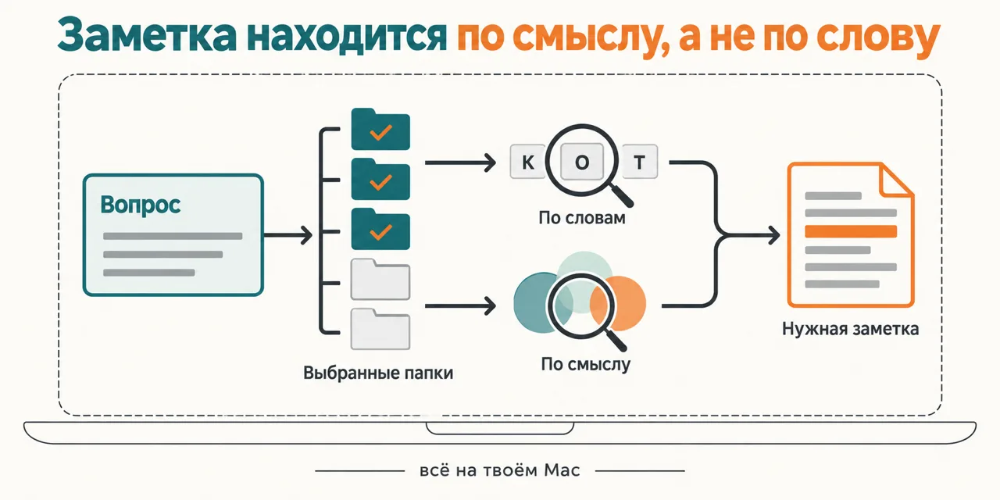
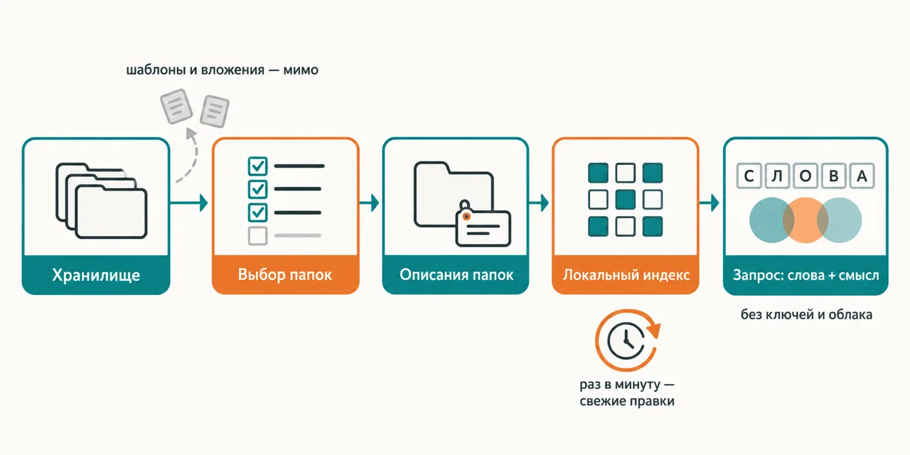

English · [Русский](README.md)

# You remember what the note was about but not the words in it — and neither Obsidian search nor Claude can find it

The plugin puts the local search engine qmd over the folders of your Obsidian vault that you pick:
notes are cut into fragments, a model computes the meaning of each one right on your Mac, and Claude
searches with two lines at once — by keywords and by meaning. No keys, no cloud, your notes never
leave the machine.

```
claude plugin marketplace add https://github.com/beCyborg/jadlis-hub
claude plugin install jadlis-memory-search@jadlis
```

Then, inside Claude Code, run `/jadlis-memory-search:memory-search-setup`: it finds the vault, shows
you the folders, builds the index and sets up auto-updates. Restart Claude Code once setup is done.



In words: on the left, a question in plain language; in the middle, a stack of vault folders where
the chosen ones are highlighted and templates and attachments are dimmed; on the right, two search
paths — by words and by meaning — meet on a single found note; everything sits inside a frame
labelled "on your Mac".

This is my own note search packaged for handing over, not a product: the same combination — qmd,
background updates and query rules — runs on my machine every day.

## Before → after

| By hand | With an AI chat | With this plugin |
|---|---|---|
| **How a note gets found.** Obsidian search goes by words: it finds the note only if you remember the word you used. | Claude greps the folder with words it guessed itself and says "not found" after two misses. | The query goes out as two lines at once — keywords and a sentence by meaning; it also finds the note where the same thing is said in other words. |
| **What gets searched.** The whole vault at once — templates, attachments and system folders included. | Whatever the grep happened to hit, in no particular order. | Only the folders you ticked in the list; templates, attachments, system and empty folders are filtered out up front, and every folder carries a one-line description. |
| **How the index learns about a new note.** You rebuild it yourself, when you remember to. | There is no index — everything is read again every time. | A background poll notices edits once a minute and tops up the index, a full reconciliation runs hourly; a new note is findable about a minute later. |
| **How much text goes into the conversation.** None — but then you are the one searching. | To find one passage, Claude reads dozens of whole files into the conversation. | The index and the meaning model live on your Mac; only the matching fragments go into the conversation, and Claude opens two or three notes in full. |
| **How the query is phrased.** You try synonyms one by one until one works. | Hand it qmd without rules and it asks with a single phrase: automatic query expansion misfires on Russian, and reranking adds seconds to every search. | The skill teaches it to ask properly: word stems for the keyword line, a full sentence for the meaning line, no slow reranking. |

## How it works



Going in — your Obsidian vault and a question in plain language.
Inside — the chosen folders become qmd collections with descriptions, the index is built and kept
fresh locally, and Claude queries by words and by meaning at the same time.
Coming out — links to notes with the matching fragments.

In words: vault → choosing folders → folder descriptions → a local index that picks up edits once a
minute → a query by words and by meaning → the notes that were found.

The search itself is done by [qmd](https://github.com/tobi/qmd) — a local search engine for Markdown
by Tobi Lütke, npm package `@tobilu/qmd`, MIT license. This plugin is a wrapper around it: install,
folder choice, descriptions, auto-updates and the rules Claude follows when it phrases a query.

**The first run.** `/jadlis-memory-search:memory-search-setup` walks you through the steps and writes
nothing to disk before the writing step.

1. **Check.** macOS or Linux, Node 22+, whether qmd is installed, how much free space there is,
   whether you already have qmd collections of your own. No qmd — it offers to install it with one
   npm command.
2. **Vault.** Finds the vaults from Obsidian's list and asks which one to index; you can also point
   it at any Markdown folder by hand.
3. **Folder list.** A table of top-level folders: note count, other files, size, last edit and three
   sample titles. Separately — what was skipped automatically: system folders, attachments,
   templates, folders with fewer than three notes. Folders over 5000 notes are flagged, and it
   offers subfolders for them.
4. **Choice.** You tick the folders you want. Each one becomes a collection with a Latin name by
   transliteration: `Входящие` → `vkhodyashchie`; you can rename it.
5. **Descriptions.** Claude reads only a summary of the folder — titles, tags, the opening lines of a
   few notes — not the notes themselves, and writes one line: "what this is: main topics". No
   names, diagnoses or money amounts. You confirm or edit.
6. **Writing and building.** Collections and descriptions go into the qmd config, and the index is
   built in the background. The index is not placed inside the vault — sync will not drag it along.
7. **Auto-updates.** Your pick: a background poll via launchd (recommended), only at Claude Code
   session start, or later.
8. **Permissions and a hint.** With your consent — permissions for the search tools in the vault's
   `.claude/settings.local.json` and a short section on search in its `CLAUDE.md`.
9. **A real test.** A search by words and by meaning on your own notes, a PASS/FAIL table and a
   reminder to restart Claude Code.

**Using it.** Ask in plain words — "where did I write about sunsets", "what did I decide about the
mountain trip" — and Claude goes to the search on its own. Or explicitly:

| Command | What it does |
|---|---|
| `/jadlis-memory-search:memory-search <question>` | search by words and by meaning, answer with links to notes |
| `… status` | collections, note and vector counts, auto-update state — in one table |
| `… reindex` | reindex now, without waiting for the background poll |
| `… add <folder>` | add a folder: summary, name, description, index build |
| `… remove <collection>` | take a collection out of the index |
| `… autoindex on\|off\|status` | turn the background updates on, off, or check them |

The short forms `/memory-search` and `/memory-search-setup` work as long as your Claude Code has no
other command with the same name. Running `memory-search-setup` again with `--recheck` rebuilds the
folder list, with `--contexts` — only the descriptions.

**What lives where.**

| What | Where |
|---|---|
| Collection list and descriptions | `~/.config/qmd/index.yml` — qmd's own config |
| Index and meaning model | `~/.cache/qmd/` |
| Copies of the poll scripts, logs, state stamps | `~/.claude/plugins/data/jadlis-memory-search-jadlis/` |
| Background poll | `~/Library/LaunchAgents/com.jadlis.memory-search.watch.plist` — only if you chose launchd |
| Permissions and the hint for Claude | `.claude/settings.local.json` and a `CLAUDE.md` section in the vault — only with your consent |

## Install and first run

You need macOS with Homebrew, Node 22+ (`brew install node`) and about 2 GB of free space. qmd itself
is installed with `npm install -g @tobilu/qmd` — `memory-search-setup` offers that command if qmd
is not there yet. On Linux the plugin runs in "hook only" mode: the index is refreshed at session
start, without the background poll.

**a) Text to paste to an agent.** Copy the whole thing into a Claude Code chat:

```
You are the installer. Install the plugin jadlis-memory-search from the jadlis marketplace on this computer.
This plugin needs no keys or secrets.
First check and tell me: whether this is macOS, which Node version is installed (22 or newer is
needed) and how much free disk space there is (about 2 GB is needed). If Node is missing or older,
stop and offer me the command brew install node.
Then run exactly these commands, verbatim, shortening nothing:
1. claude plugin marketplace add https://github.com/beCyborg/jadlis-hub
2. claude plugin install jadlis-memory-search@jadlis
3. claude plugin list — show me the line about jadlis-memory-search and its version.
Then tell me in one line: restart Claude Code in the vault folder and type
/jadlis-memory-search:memory-search-setup.
Before each command show it to me in full and wait for "yes". If I say "no", do not run it,
tell me what you skipped, and move on.
If a command returns an error, stop, show me the output, and do not move to the next one.
```

**b) Commands by hand.**

```
claude plugin marketplace add https://github.com/beCyborg/jadlis-hub
claude plugin install jadlis-memory-search@jadlis
claude plugin list
```

The first command installs nothing — it adds the marketplace. Only the second one installs.

**c) The first run.** Open Claude Code in the vault folder and type:

```
/jadlis-memory-search:memory-search-setup
```

When setup is done, restart Claude Code: the search engine reads the collection list when the
session starts. The first index build runs in the background and downloads the meaning model once,
about 320 MB. If the command is not found, check the name with `claude plugin list`.

## Limits, cost, updates

**What it does not do.** It does not search outside the chosen folders and does not touch other
vaults. It sends notes to no cloud and asks for no keys. It does not change your existing qmd
collections without asking — if you already have qmd, setup shows what is in it and asks how to
proceed. It does not replace exact search: an exact string, path or identifier is a job for plain
grep.

**What you need.** macOS with Homebrew, Node 22+, qmd (`npm install -g @tobilu/qmd`), about 2 GB of
free space. The first build downloads the meaning model, about 320 MB; qmd's reranker and generator
are not needed — the skill does not use them. Auto-updates via launchd are macOS only; on Linux the
index is refreshed at session start, and setup gives you a crontab line if you want the background
poll.

**Memory and freshness.**

- Every Claude Code session starts its own qmd process — up to ~0.5 GB of memory per session. One or
  two sessions go unnoticed; five or more in parallel get heavy.
- A new note becomes findable about a minute after you save it; without launchd — from the next
  session start.
- The collection list is read at session start: after `add` or `remove`, restart Claude Code.
- The tails of very long notes and deep table cells are found by keywords rather than by meaning:
  the meaning model sees the beginning of each fragment, not all of its text.

**How tokens get spent.** A run is light: a query returns short fragments, and Claude opens two or
three notes in full, no more. Setup reads folder summaries, not the notes. The plugin costs no
money: the index, the model and the search run on your Mac, there are no paid APIs.

**Verified where I work:** my Apple Silicon Mac, qmd 2.8.3, a copy of my vault in a separate Claude
Code profile. Linux in "hook only" mode and Intel Macs are untested; on Intel the first build takes
noticeably longer, and setup warns you about it.

**Uninstalling.** Order matters: the background poll runs from the plugin's data folder, and if you
remove the plugin first, the poll is left without its scripts.

```
/jadlis-memory-search:memory-search autoindex off
```

```
claude plugin uninstall jadlis-memory-search@jadlis --keep-data
```

Without `--keep-data` the logs and state stamps are deleted too. The qmd index lives separately: the
index itself in `~/.cache/qmd/`, the collection list in `~/.config/qmd/index.yml`; a collection is
removed with `qmd collection remove <name>`. Remove the permissions and the `CLAUDE.md` section in
the vault by hand if you no longer need them.

**Terms of use.** There is no license: all rights reserved by the author. You may read it and use it
personally. Commercial use, republishing and bundling it into your own products — by arrangement
with me.

**Third-party code.** qmd is not bundled into the plugin: it is installed from npm separately and
stays under its own MIT license and with its author, Tobi Lütke (<https://github.com/tobi/qmd>).

**Updates.** With a third-party marketplace, auto-update is off on your side: until you run the
first command you keep the version you installed. The background poll picks up the new scripts on
its own at the next session start.

```
claude plugin marketplace update jadlis && claude plugin update jadlis-memory-search@jadlis
claude plugin list
```

Reinstall, if something ended up crooked:

```
claude plugin uninstall jadlis-memory-search@jadlis --keep-data && claude plugin install jadlis-memory-search@jadlis
```
