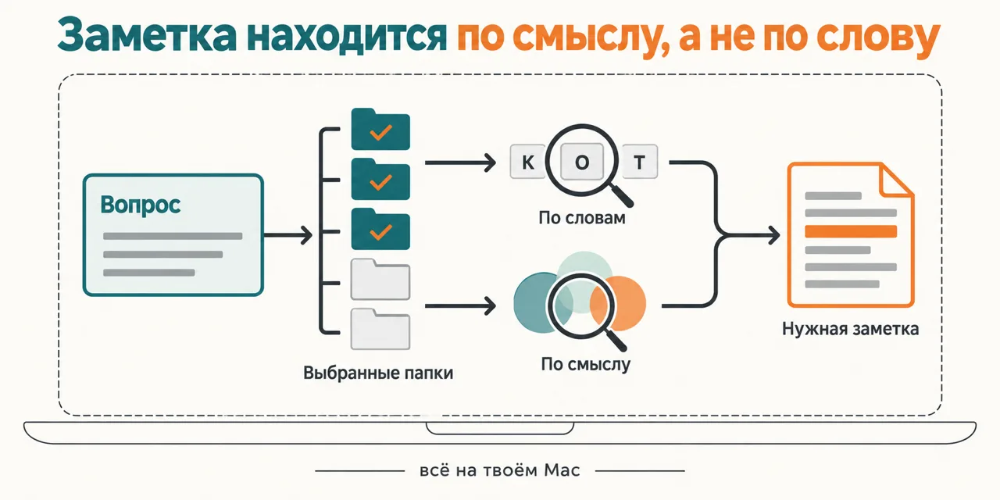
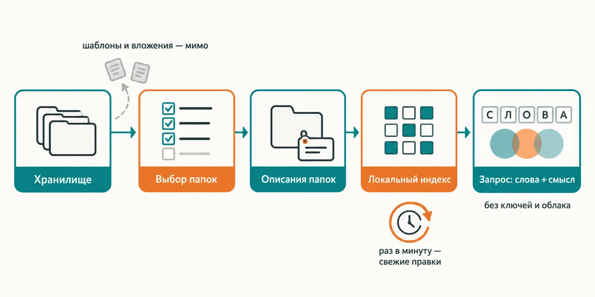

Русский · [English](README.en.md)

# Помнишь, о чём была заметка, но не помнишь слов — и ни поиск Obsidian, ни Claude её не находят

Плагин ставит локальный поисковик qmd над теми папками хранилища Obsidian, которые ты выбрал:
заметки режутся на фрагменты, смысл каждого считается моделью прямо на твоём Mac, и Claude ищет
сразу двумя строками — по ключевым словам и по смыслу. Ключей нет, облака нет, заметки с машины
не уходят.

```
claude plugin marketplace add https://github.com/beCyborg/jadlis-hub
claude plugin install jadlis-memory-search@jadlis
```

Дальше в Claude Code — `/jadlis-memory-search:memory-search-setup`: он найдёт хранилище, покажет
папки, соберёт индекс и поставит автообновление. После настройки перезапусти Claude Code.



Текстом: слева вопрос обычными словами, посередине стопка папок хранилища, где выбранные
подсвечены, а шаблоны и вложения приглушены, справа два пути поиска — по словам и по смыслу —
сходятся на одной найденной заметке; всё обведено рамкой «на твоём Mac».

Это мой рабочий поиск по заметкам, упакованный для передачи, а не продукт: та же связка — qmd,
фоновое обновление и правила запроса — у меня работает каждый день.

## Было → стало

| Руками | Чатом с ИИ | Этим плагином |
|---|---|---|
| **Как находится заметка.** Поиск Obsidian ищет по словам: находит, только если помнишь, каким словом ты это записал. | Claude грепает папку словами, которые сам угадал, и после двух промахов говорит «не нашёл». | Запрос уходит двумя строками сразу — ключевые слова и фраза по смыслу; находится и заметка, где то же самое сказано другими словами. |
| **Что попадает в поиск.** Всё хранилище разом — вместе с шаблонами, вложениями и служебными папками. | То, на что наткнулся греп, в случайном порядке. | Только папки, которые ты отметил в списке; шаблоны, вложения, служебные и пустые папки отсеиваются заранее, у каждой папки есть описание в одну строку. |
| **Как индекс узнаёт о новой заметке.** Пересобираешь сам, когда вспомнишь. | Индекса нет — каждый раз всё читается заново. | Фоновый опрос раз в минуту замечает правки и дособирает индекс, раз в час идёт полная сверка; новая заметка находится примерно через минуту. |
| **Сколько текста уходит в разговор.** Нисколько — но и ищешь ты сам. | Чтобы найти одно место, Claude читает в разговор десятки файлов целиком. | Индекс и модель смысла живут на твоём Mac; в разговор попадают только найденные фрагменты, а целиком Claude открывает две-три заметки. |
| **Как формулируется запрос.** Перебираешь синонимы по очереди, пока не повезёт. | Дай ему qmd без правил — спросит одной фразой: на русском автоматическое расширение запроса уходит мимо, а переранжирование добавляет секунды к каждому поиску. | Скилл учит спрашивать правильно: основы слов для поиска по словам, полное предложение для поиска по смыслу, без медленного переранжирования. |

## Как это работает



На входе — твоё хранилище Obsidian и вопрос обычными словами.
Внутри — выбранные папки становятся коллекциями qmd с описаниями, индекс строится и обновляется
локально, а Claude задаёт запрос сразу по словам и по смыслу.
На выходе — ссылки на заметки с найденными фрагментами.

Текстом: хранилище → выбор папок → описания папок → локальный индекс, который раз в минуту
подхватывает правки → запрос по словам и по смыслу → найденные заметки.

Сам поиск делает [qmd](https://github.com/tobi/qmd) — локальный поисковик по Markdown, автор
Tobi Lütke, пакет npm `@tobilu/qmd`, лицензия MIT. Этот плагин — обвязка вокруг него: установка,
выбор папок, описания, автообновление и правила, по которым Claude формулирует запрос.

**Первый запуск.** `/jadlis-memory-search:memory-search-setup` ведёт по шагам и до шага записи
ничего не пишет на диск.

1. **Проверка.** macOS или Linux, Node 22+, установлен ли qmd, сколько свободного места, есть ли
   у тебя уже свои коллекции qmd. Нет qmd — предложит поставить его одной командой npm.
2. **Хранилище.** Находит хранилища из списка Obsidian и спрашивает, какое индексировать; можно
   указать любую папку с Markdown вручную.
3. **Список папок.** Таблица по верхним папкам: сколько заметок, сколько прочих файлов, объём,
   последняя правка и три примера заголовков. Отдельно — что пропущено автоматически: служебные
   папки, вложения, шаблоны, папки меньше чем из трёх заметок. Папки больше 5000 заметок
   помечены — для них предложит подпапки.
4. **Выбор.** Отмечаешь нужные папки. Каждая становится коллекцией с латинским именем по
   транслиту: `Входящие` → `vkhodyashchie`; имя можно поменять.
5. **Описания.** Claude читает только сводку по папке — заголовки, теги, начала нескольких
   заметок, — а не сами заметки, и пишет одну строку «что это: главные темы». Без имён, диагнозов
   и денежных сумм. Ты подтверждаешь или правишь.
6. **Запись и сборка.** Коллекции и описания уходят в конфиг qmd, индекс строится в фоне.
   В само хранилище индекс не кладётся — синхронизация его не потащит.
7. **Автообновление.** На выбор: фоновый опрос через launchd (рекомендую), только при старте
   сессии Claude Code или позже.
8. **Права и подсказка.** С твоего согласия — разрешения на инструменты поиска в
   `.claude/settings.local.json` хранилища и короткая секция про поиск в его `CLAUDE.md`.
9. **Проверка делом.** Поиск по словам и по смыслу на твоих же заметках, таблица PASS/FAIL
   и напоминание перезапустить Claude Code.

**Как пользоваться.** Спрашивай обычными словами — «где я писал про закаты», «что я решил про
поездку в горы», — Claude сам пойдёт в поиск. Или явно:

| Команда | Что делает |
|---|---|
| `/jadlis-memory-search:memory-search <вопрос>` | поиск по словам и по смыслу, ответ со ссылками на заметки |
| `… status` | коллекции, число заметок и векторов, состояние автообновления — одной таблицей |
| `… reindex` | переиндексировать сейчас, не дожидаясь фонового опроса |
| `… add <папка>` | добавить папку: сводка, имя, описание, сборка индекса |
| `… remove <коллекция>` | убрать коллекцию из индекса |
| `… autoindex on\|off\|status` | включить, выключить или проверить фоновое обновление |

Короткие формы `/memory-search` и `/memory-search-setup` работают, если в твоём Claude Code нет
другой команды с тем же именем. Повторный `memory-search-setup` с `--recheck` пересобирает список
папок, с `--contexts` — только описания.

**Что где лежит.**

| Что | Где |
|---|---|
| Список коллекций и описаний | `~/.config/qmd/index.yml` — конфиг самого qmd |
| Индекс и модель смысла | `~/.cache/qmd/` |
| Копии скриптов опроса, логи, отметки состояния | `~/.claude/plugins/data/jadlis-memory-search-jadlis/` |
| Фоновый опрос | `~/Library/LaunchAgents/com.jadlis.memory-search.watch.plist` — только если выбрал launchd |
| Права и подсказка для Claude | `.claude/settings.local.json` и секция `CLAUDE.md` в хранилище — только с твоего согласия |

## Установка и первый запуск

Нужны macOS с Homebrew, Node 22+ (`brew install node`) и около 2 ГБ свободного места. Сам qmd
ставится командой `npm install -g @tobilu/qmd` — `memory-search-setup` предложит её, если qmd
ещё нет. На Linux плагин работает в режиме «только хук»: индекс обновляется при старте сессии,
без фонового опроса.

**а) Текст для вставки агенту.** Скопируй целиком в чат Claude Code:

```
Ты — установщик. Поставь на этот компьютер плагин jadlis-memory-search из маркетплейса jadlis.
Ключей и секретов этому плагину не нужно.
Сначала проверь и скажи мне: macOS ли это, какая версия Node (нужна 22 или новее) и сколько
свободного места на диске (нужно около 2 ГБ). Node нет или он старее — остановись и предложи
мне команду brew install node.
Выполни ровно эти команды, дословно, ничего не сокращая:
1. claude plugin marketplace add https://github.com/beCyborg/jadlis-hub
2. claude plugin install jadlis-memory-search@jadlis
3. claude plugin list — покажи мне строку про jadlis-memory-search и его версию.
Потом скажи мне одной строкой: перезапусти Claude Code в папке хранилища и набери
/jadlis-memory-search:memory-search-setup.
Перед каждой командой покажи её мне целиком и дождись «да». Сказал «нет» — не выполняй,
скажи, что именно пропустил, и иди дальше.
Команда вернула ошибку — остановись, покажи вывод, к следующей не переходи.
```

**б) Команды руками.**

```
claude plugin marketplace add https://github.com/beCyborg/jadlis-hub
claude plugin install jadlis-memory-search@jadlis
claude plugin list
```

Первая команда ничего не ставит — она добавляет маркетплейс. Ставит только вторая.

**в) Первый запуск.** Открой Claude Code в папке хранилища и набери:

```
/jadlis-memory-search:memory-search-setup
```

Когда настройка закончится, перезапусти Claude Code: список коллекций поисковик читает при старте
сессии. Первая сборка индекса идёт в фоне; при ней один раз качается модель смысла, около 320 МБ.
Не находится команда — сверь имя строкой `claude plugin list`.

## Границы, стоимость, обновление

**Чего не делает.** Не ищет за пределами выбранных папок и не трогает другие хранилища. Не
отправляет заметки ни в какое облако и не просит ключей. Не меняет твои существующие коллекции
qmd без спроса — если qmd у тебя уже стоит, настройка покажет, что в нём есть, и спросит, как
быть. Не заменяет точный поиск: точная строка, путь или идентификатор — это обычный grep.

**Что нужно.** macOS с Homebrew, Node 22+, qmd (`npm install -g @tobilu/qmd`), около 2 ГБ
свободного места. При первой сборке качается модель смысла, около 320 МБ; переранжировщик и
генератор qmd не нужны — скилл ими не пользуется. Автообновление через launchd — только macOS; на
Linux индекс обновляется при старте сессии, а настройка даст строку для crontab, если хочешь
фоновый опрос.

**Память и свежесть.**

- Каждая сессия Claude Code поднимает свой процесс qmd — до ~0,5 ГБ памяти на сессию. Одна-две
  сессии не заметны, пять и больше параллельно — уже тяжело.
- Новая заметка находится примерно через минуту после сохранения; без launchd — со следующего
  старта сессии.
- Список коллекций читается при старте сессии: после `add` или `remove` перезапусти Claude Code.
- Хвосты очень длинных заметок и глубокие ячейки таблиц находятся по ключевым словам, а не по
  смыслу: модель смысла видит начало каждого фрагмента, а не весь его текст.

**Порядок расхода токенов.** Прогон лёгкий: запрос возвращает короткие фрагменты, а целиком
Claude открывает две-три заметки, не больше. Настройка читает сводки по папкам, а не сами
заметки. Денег плагин не стоит: индекс, модель и поиск работают на твоём Mac, платных API нет.

**Проверено там, где я работаю:** мой Mac на Apple Silicon, qmd 2.8.3, копия моего хранилища
в отдельном профиле Claude Code. Linux в режиме «только хук» и Intel-Mac не проверялись; на
Intel первая сборка заметно дольше, настройка об этом предупредит.

**Удаление.** Порядок важен: фоновый опрос запускается из папки данных плагина, и если снести
плагин первым, опрос останется без своих скриптов.

```
/jadlis-memory-search:memory-search autoindex off
```

```
claude plugin uninstall jadlis-memory-search@jadlis --keep-data
```

Без `--keep-data` удалятся и логи с отметками состояния. Индекс qmd живёт отдельно: сам индекс —
в `~/.cache/qmd/`, список коллекций — в `~/.config/qmd/index.yml`; коллекция убирается командой
`qmd collection remove <имя>`. Права и секцию в `CLAUDE.md` хранилища, если они больше не нужны,
убери руками.

**Условия использования.** Лицензии нет: все права сохранены за автором. Читать и
пользоваться лично можно. Коммерческое использование, переиздание и включение в свои
продукты — по договорённости со мной.

**Сторонний код.** qmd в плагин не встроен: он ставится из npm отдельно и живёт под своей
лицензией MIT и за своим автором, Tobi Lütke (<https://github.com/tobi/qmd>).

**Обновление.** У стороннего маркетплейса авто-обновление на твоей стороне выключено: пока не
запустишь первую команду, у тебя остаётся та версия, которую ты поставил. Фоновый опрос
подхватит новые скрипты сам при следующем старте сессии.

```
claude plugin marketplace update jadlis && claude plugin update jadlis-memory-search@jadlis
claude plugin list
```

Переустановка, если что-то встало криво:

```
claude plugin uninstall jadlis-memory-search@jadlis --keep-data && claude plugin install jadlis-memory-search@jadlis
```
